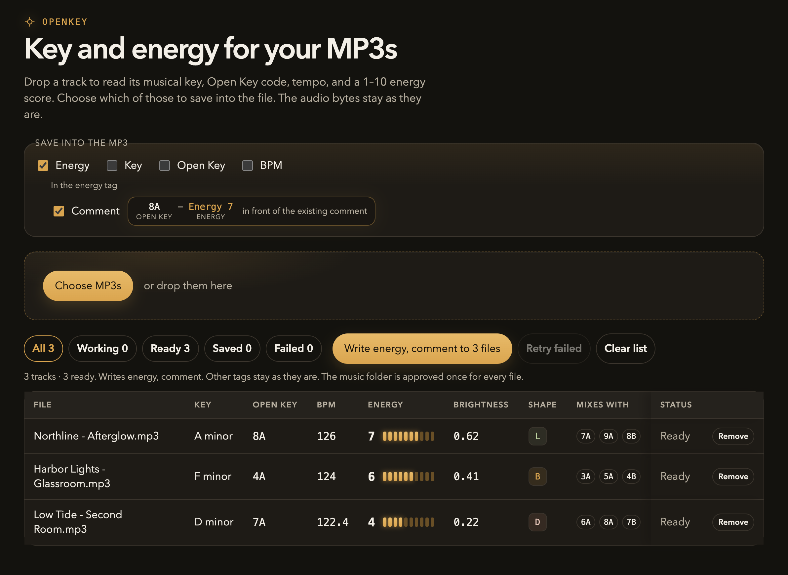

# openkey

openkey reads an MP3 in the browser and tells you the musical key, the Open Key code, the tempo, and how the track feels. You choose which of those facts are written back into the original file. The audio is not re-encoded. Artwork, DJ markers, and every tag you leave unselected stay as they are.

- 🎹 **Key** — musical key, for example `A minor`. A weak estimate is marked.
- 🔄 **Open Key** — the Camelot code, plus the three codes it mixes with.
- ⚡ **Energy** — 1–10 for electronic music. A steady club track lands around 7. Written to the energy tag.
- 💬 **Comment** — Open Key and energy in the Mixed In Key form, `8A - Energy 7`, in front of the existing note.
- 🌗 **Shape** — L stays level, B builds, D jumps. Shown in the table, not written to the file.



Chrome or Edge can overwrite the file in place. Safari can show a result, but it cannot write the original MP3.

## Run

```bash
npm install
npm run dev
```

Open the address Vite prints. Drop MP3s on the page, or choose them. Analysis runs one file at a time. The track list scrolls on its own, and the status filters stay in view.

## What a row means

| Column | What it is |
| --- | --- |
| Key | Musical key from Essentia, for example `A minor` or `F# major`. Flats are shown as sharps, so B flat becomes `A#`. If the estimate is weak, the row says **Low confidence**. |
| Open Key | The same key on the Camelot wheel. A minor is `8A`. C major is `8B`. Minor keys use A, major keys use B. |
| Mixes with | The three codes that sit next to this one: the previous code, the next code, and the relative major or minor. `8A` mixes with `7A`, `9A`, and `8B`. |
| BPM | Tempo from Essentia’s Percival estimator, to one decimal. `126` stays `126`. `122.36` becomes `122.4`. |
| Energy | A 1–10 intensity score for electronic music. A steady club track lands around 7. A sparser groove lands around 4. This is not a loudness meter, so a brickwalled master does not automatically score high. |
| Brightness | How much of the signal sits above 5 kHz, from 0 to 1. `0.00` is dark. `1.00` is bright. Shown to two decimals. |
| Shape | How the drive changes through the track. **L** stays level, **B** builds, **D** jumps between a quiet stretch and a peak. Hover a letter for the plain-language description. |
| Status | Queued, analyzing, ready, saving, saved, or failed. Remove drops that row. It does not delete the MP3. |

Brightness and shape are there to read. They are not written into the file.

The same file always produces the same energy, brightness, and shape. A track that was tagged earlier keeps the old tags until you analyze it again and write.

## What gets saved

Energy and Comment are on by default. Key, Open Key, and BPM stay off, so those tags are left alone until you turn them on. Nothing you leave unchecked is deleted.

**Energy** goes into the energy tag DJ software reads: an ID3 `TXXX` frame described as `EnergyLevel`, with a value from `1` to `10`.

**Comment** is only available while Energy is on. It does not replace the energy tag. It copies the Open Key and the energy into the comment, in the form Mixed In Key uses:

```text
8A - Energy 7
```

That token is placed in front of a note that is already there. An older energy token is replaced, so the comment does not collect copies.

| Comment before | Comment after |
| --- | --- |
| *(empty)* | `8A - Energy 7` |
| `www.Beatport.com` | `8A - Energy 7 www.Beatport.com` |
| `Intro \| Energy 4` | `8A - Energy 7 Intro` |
| `11A - Energy 4 Intro` | `8A - Energy 7 Intro` |

Turn Comment off and the energy tag is still written. The existing comment stays untouched. Turn Energy off and neither is written.

| Choice | Written tag |
| --- | --- |
| Energy | `TXXX` / `EnergyLevel`, value `1`–`10` |
| Key | `TKEY`, for example `Am` or `F#` |
| Open Key | `TKEY`, for example `8A` |
| Key and Open Key together | `TKEY` keeps the Open Key code. `TXXX` / `MusicalKey` keeps the musical name, for example `A minor` |
| BPM | `TBPM`, the same number shown in the table |
| Comment | With Energy on, `8A - Energy 7` in front of the existing comment |

ID3v2.2 files are refused. If a frame that has to change is compressed or encrypted, the file is left unchanged. The first save asks once for the folder that contains the tracks. After that, Chrome can update every MP3 in that folder without asking again for each file.

## How the numbers are made

Energy is a weighted mix of four Essentia measurements, scaled for club music and rounded to an integer from 1 to 10:

| Share | Measurement | Quiet end | Full end |
| --- | --- | --- | --- |
| 40% | Onsets per second | 0.8 | 5.5 |
| 35% | Danceability | 0.4 | 2.2 |
| 15% | Power above 5 kHz | 3% | 18% |
| 10% | Dynamic complexity | 2 | 10 |

Danceability values above 3.5 are ignored. A flat tone makes that measurement explode, and it should not look like a club track. If the rhythm estimate fails, energy falls back to the high-frequency share alone. Key and BPM are still reported.

Brightness uses only that high-frequency share, mapped from 0.03–0.18 onto 0–1.

Shape listens to onset density, not loudness. It samples about 15 seconds at the start, at 35%, at the middle, and at 75% of the file. The gap between the quietest and the busiest of those windows decides the letter: under 0.15 is L, under 0.35 is B, and anything wider is D.

## Develop

```bash
npm test
npm run lint
```

essentia.js is AGPL-3.0. That license applies if this app is distributed.

## Sponsor

If openkey is useful, you can support the work on [GitHub Sponsors](https://github.com/sponsors/ChrisEdS).
